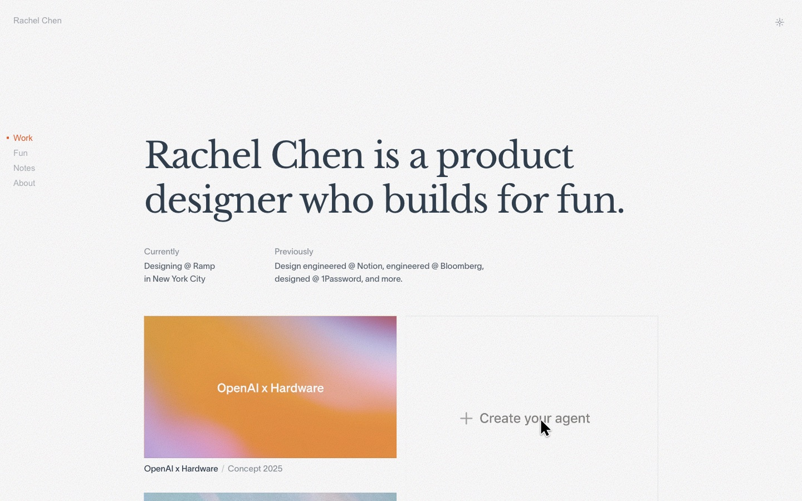
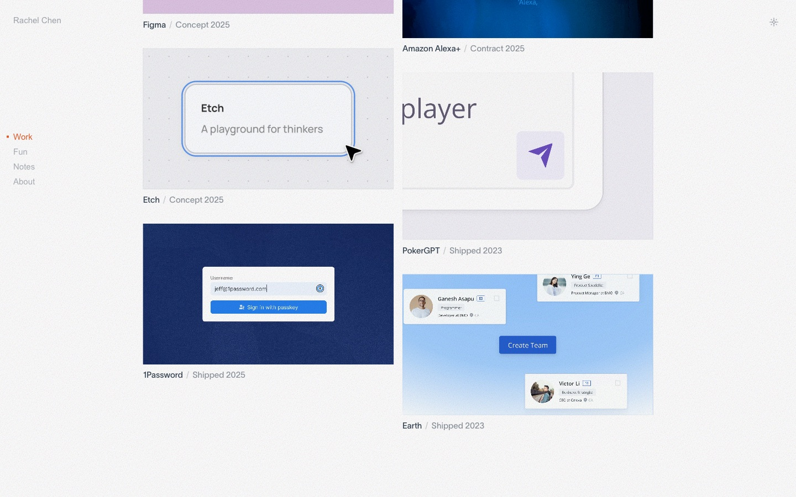
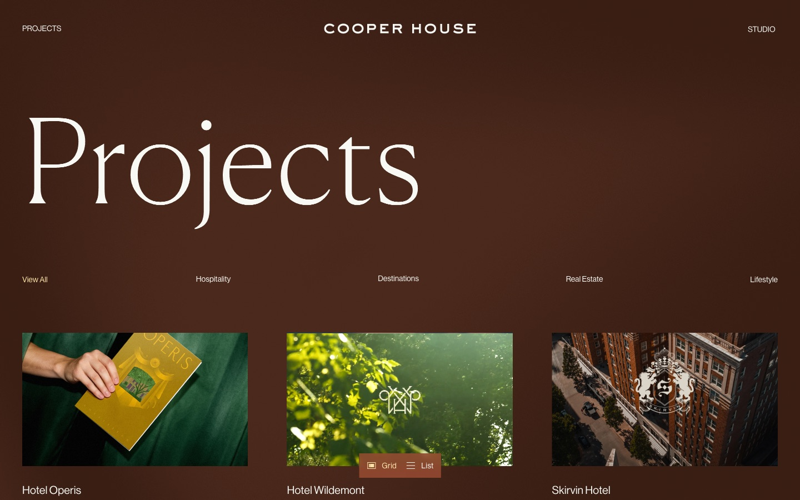
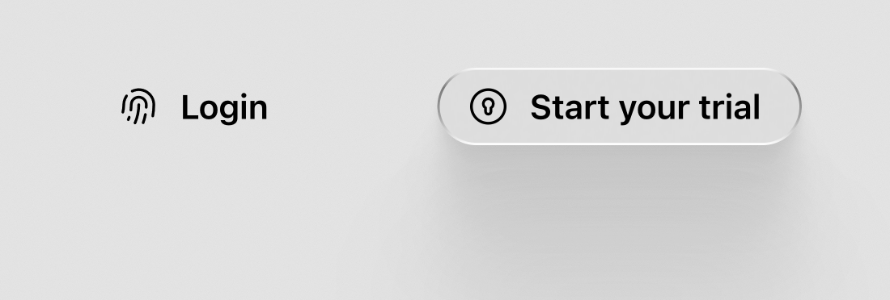
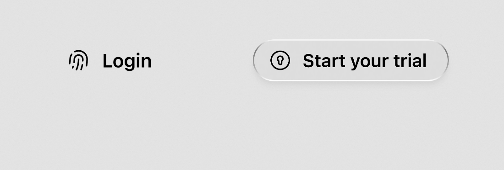
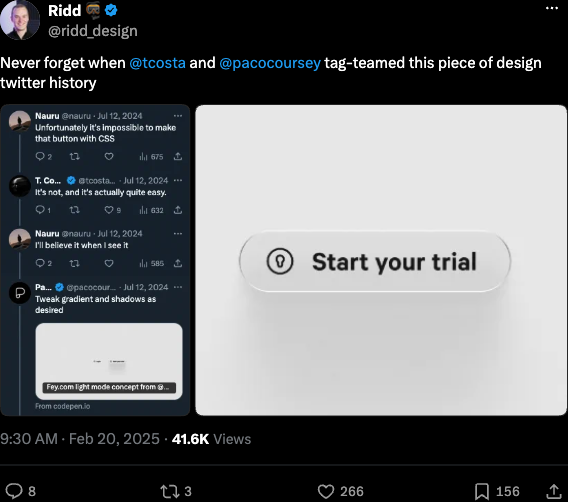

# joshuaogle.com design

How joshuaogle.com looks and why. This records the thinking behind the 2027 redesign as it happens, so the next redesign can start from the reasoning, not just the result.

Screenshots of past designs and full-size captures of everything below live in the JoshuaOgle.com Figma file: past designs each have a page ("2024 Dot grid", "2023 Glass Pane Design"), and this inspiration is in the Inspiration section of the "2027" page.

## Inspiration

### Rachel Chen

[rachelchen.tech](https://www.rachelchen.tech)

- **One sentence as the introduction.** A big serif headline does all the talking; everything around it is small, quiet sans.
- **Work shown as moving product.** Each project tile is a short video of the actual interface, captioned with name, type and year ("Concept 2025", "Shipped 2026").
- **A frame, not a page.** Name and side navigation stay put while the work scrolls inside the frame, with a faint noise texture over everything.

### Cooper House

[cooper-house.com/projects](https://www.cooper-house.com/projects)

- **One warm color carries the brand.** The whole page is a single deep brown; the photography supplies every other color.
- **A big, light serif title and then straight into the work.** A dense three-column grid with filter tabs (Hospitality, Destinations, Real Estate, Lifestyle) and a grid/list toggle.
- **Two-line captions.** Project name, then a one-line tagline.

### Glass buttons

[CodePen by Paco Coursey](https://codepen.io/pxco/pen/eYwNErz): "Fey.com light mode concept from @narative". Reposted by [Ridd on X](https://x.com/ridd_design/status/1892612694764904599) as "design twitter history": someone said the button was impossible to make with CSS, @tcosta said it was easy, and @pacocoursey built it.

How it's built, from the pen's source:

- **Almost no fill.** `rgba(105, 105, 105, 0.04)` with a 1px `backdrop-filter` blur. The glass is mostly the edge and the shadow.
- **A rim of light.** A 1px gradient border (white at the top, grey through the middle, white at the bottom) drawn on a `::before` with `padding` plus `mask-composite: exclude`, so only the edge shows and the corners stay round.
- **A long, soft shadow.** Six stacked shadows, from 2px to 78px offset, each at 2–10% black. Together they read as one deep, diffuse shadow, like light through glass.
- **A physical press.** On `:active` the shadow drops to its two closest layers and the button scales to 95%, over 200ms.
- **Paper behind it.** The page is `#e7e7e7` with SVG `feTurbulence` noise at 20% opacity, which gives the blur and the rim something to catch.

Notes for using it here:

- **It's tuned for a light, mid-grey background.** On a dark page, black shadows disappear and the grey parts of the rim go muddy. A dark version needs its own rim gradient and a glow or lighter shadow instead.
- **One special button, not a button style.** It's at its best as the single primary action, like "Let's talk". On every link it would stop feeling special.
- **The pen has no focus style.** It needs a `:focus-visible` treatment that fits the rim, and the press should stay subtle under `prefers-reduced-motion`.
- **Skip `will-change: transform`** on buttons that rarely animate; it costs memory for no visible gain.
